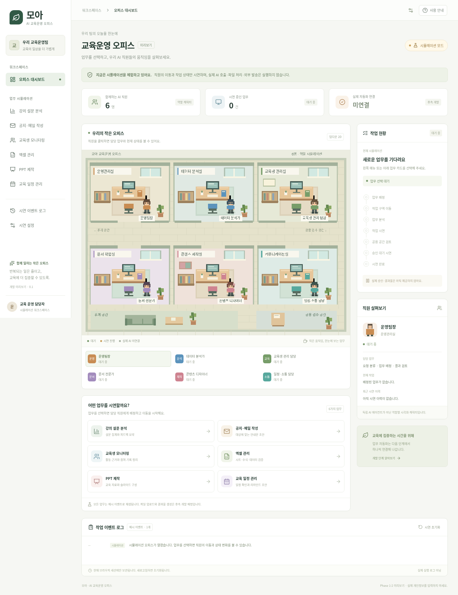

# ai-education-office

## 모아 · AI 교육운영 오피스

교육 운영 업무의 흐름을 탑다운 2D 픽셀아트 사무실에서 보여주는 한국어 웹 애플리케이션입니다. **오피스 시뮬레이션과 Phase 3의 계정 로그인·복구·업무 영구 저장·XLSX/CSV 원본 첨부·미리보기·열 선택·기초 집계·CSV 내보내기** 기능을 구현했습니다. 실제 AI 호출, AI 자동 분석, AI 보고서·문서 생성, 승인 처리, 메시지 발송은 하지 않습니다. 직원 6명은 독립 에이전트가 아닌 역할별 시각화 캐릭터입니다.



[모바일 화면 보기](docs/images/office-mobile.png)

[업무 요청·저장 화면(계정 저장 단계)](docs/images/requests-desktop.png) · [모바일 업무 화면(계정 저장 단계)](docs/images/requests-mobile.png)

[계정 화면](docs/images/account-desktop.png) · [모바일 계정 화면](docs/images/account-mobile.png)

### 구현한 기능

- React·TypeScript·Vite·Phaser·Tailwind CSS·Lucide 기반 한국어 반응형 UI
- 사무실 6곳, 공용 검수 공간, 휴게 공간 및 책상·모니터·화분·책장·소파
- 직원 6명, 걷기·대기 애니메이션, 복도를 따라 이동하는 경로
- 설문 분석 / 공지·메일 / 교육생 모니터링 / 엑셀 / PPT / 교육 일정의 6가지 업무 시연
- 업무 배정 → 이동 → 분석 → 작성·실행 → 검토 → 승인 대기 시연 → 시연 완료
- 캐릭터 클릭 또는 키보드로 직원 선택: 직무·상태·현재 작업·최근 시연 이력
- 오른쪽 작업 현황, 하단 예시 이벤트 로그, 초기화 및 오류 상황 시연
- 동작 줄이기 설정 지원, 실제 진행률로 오해할 수 있는 임의 퍼센트 미사용
- 업무 요청 폼, Express·SQLite 영구 저장, 목록·상세·접수 이벤트 조회
- 새로고침·서버 재시작 후 업무 복원, 계정별 권한·다른 브라우저에서 이력 복원, 재시도 중복 방지
- 회원가입·로그인·로그아웃, 일회용 복구 코드·재발급, 기존 브라우저 이력 가져오기
- 계정 소유 업무에 XLSX·UTF-8 CSV 원본 첨부·목록·다운로드 (파일당 5MiB, 업무당 5개), 해시 검증·원본 보존
- CSV·XLSX 시트·제목 행·최대 20행 미리보기, 분석할 열 선택·영구 저장·충돌 방지
- 저장한 선택 열의 전체 데이터 기초 집계: 공란 행 제외·열별 누락·값별 빈도·수식/오류 제외 건수
- 숫자 기초 집계: 숫자 인정·비숫자·범위 초과 건수, 정확한 십진 합계·평균·최솟값·최댓값, 화면·CSV·HTML 반영
- 설문 문항·정수 척도·필수 응답 설정, 유효 응답 행·문항별 유효값 통계, CSV·HTML 반영
- 파일별 백그라운드 집계 큐: 대기·실행·완료·실패·취소, 중복 접수 방지·재시작 복구·저장 결과 조회·실행별 CSV/HTML/XLSX 보관 다운로드
- 분석 결과 XLSX 다운로드: 안내·전체 요약·열별 집계·설문 문항·전체 빈도, 긴 값 분할·명시적 텍스트 셀
- 실제 빈도 막대 그래프·인쇄용 HTML 보고서 다운로드
- 전체 빈도 CSV 다운로드: 계산 기준·원본 해시·선택 버전 포함, 텍스트 수식 주입 방지
- 저장한 요청은 ‘접수됨 · 자동 실행 미연결’로 표시하며 캐릭터 시연과 분리

### 실행 방법

Node.js **24 이상**, npm 사용. SQLite는 Node.js 내장 `node:sqlite`를 이용합니다. Windows 10/11의 최신 Chrome·Edge에서 이용할 수 있습니다. Windows 자체에서 자동 테스트한 것은 아니며, Linux Chromium의 데스크톱·모바일 화면 크기로 검증합니다.

저장소 루트에서 실행합니다.

```sh
npm ci
npm run dev
```

위 명령은 API 서버(3001)와 Vite(5173)를 함께 시작합니다. Vite가 출력하는 개발 서버 주소를 브라우저에서 엽니다. `/api`는 Vite가 API 서버로 전달합니다. 클라우드에서는 해당 환경의 접속 방식을 사용하세요. 기본 계정 로그인을 제공하지만 공개 운영 배포·본인 확인·조직 권한은 아직 준비하지 않았습니다. API 서버는 기본적으로 루프백에 바인딩됩니다.

이 클라우드 환경처럼 기본 npm 캐시 경로를 쓸 수 없으면 다음 명령을 사용합니다.

```sh
npm --cache /workspace/.cache/npm ci
```

빌드와 검사:

```sh
npm run typecheck
npm test
npm run build
npm run preview
```

`npm run build`는 `frontend/dist/`와 `backend/dist/`를 만듭니다. `npm run preview`는 UI와 API를 같은 서버에서 제공합니다(기본 3001). API 키·Python은 필요하지 않습니다. 기본 DB는 `database/office.sqlite`이며 자동 생성됩니다. `PORT`, `HOST`, `OFFICE_DB_PATH`로 서버 설정을 바꿀 수 있고 상대 DB 경로는 저장소 루트 기준입니다. 개발 시에는 기본 API 포트 3001을 유지하세요.

오피스 시연은 새로고침 시 초기화되지만 저장한 업무는 계정에 유지됩니다. 처음에는 회원가입하고 한 번 표시하는 복구 코드를 안전하게 보관하세요. 같은 계정으로 다른 브라우저에서 로그인해 이력을 복원할 수 있습니다. 로그인 쿠키는 7일 유효하며 만료 후 재로그인하면 됩니다. 비밀번호를 잊으면 복구 코드로 재설정하고 모든 기존 로그인을 종료합니다.

이전 버전의 브라우저 쿠키가 유효하면 로그인 후 ‘기존 이력 가져오기’를 제공합니다. 자동으로 이전하지 않으며, 원래 쿠키를 잃은 익명 이력은 임의 계정으로 연결하지 않습니다. DB는 암호화되지 않았습니다. [계정·권한·복구 안내](docs/AUTHENTICATION.md)를 확인하고 실제 개인정보를 업무 요청에 입력하지 마세요.

### 단일 HTML 미리보기

채팅의 HTML 미리보기나 별도의 파일 뷰어에 개발용 `frontend/index.html`을 그대로 올리면 `/src/main.tsx`와 패키지를 불러올 Vite 서버가 없어 실행할 수 없습니다. 다음 명령으로 React·Phaser·CSS를 모두 포함한 미리보기 파일을 만듭니다.

```sh
npm run build:preview
```

출력은 `preview/index.html` 하나입니다. 외부 CDN·서버·이미지 파일 요청 없이 실행하도록 구성했습니다. **이 단일 HTML은 오피스 시연 전용**이며 백엔드가 필요한 로그인·업무 요청·저장 화면은 제공하지 않습니다. 생성물은 Git에서 제외하고 필요할 때 재생성합니다. 미리보기 UI가 스크립트 실행을 제한하면 파일을 내려받아 일반 브라우저에서 확인하세요. 채팅 제품 자체의 렌더러 실행은 여기서 직접 제어하거나 검증할 수 없습니다.

`npm run test:preview`는 단일 HTML을 일반 문서와 `sandbox="allow-scripts"` iframe에 각각 넣어 데스크톱·모바일 Chromium에서 직원 표시와 업무 시연 완료, 자바스크립트 예외·외부 HTTP 요청 없음을 검사합니다. 시뮬레이션 ID는 세션 내 카운터를 사용하므로 격리된 미리보기에서 없는 `crypto.randomUUID`에 의존하지 않습니다.

### 브라우저 자동 테스트

```sh
# 시스템 Chromium이 없는 PC에서 최초 한 번 실행
npx playwright install chromium
npm run test:e2e
npm run test:dev
npm run test:preview
```

Linux에 `/usr/bin/chromium`이 있으면 자동으로 재사용합니다. 다른 실행 파일은 `PLAYWRIGHT_CHROMIUM_EXECUTABLE_PATH`로 지정할 수 있습니다. `test:e2e`는 빌드 후 별도 DB(`database/e2e.sqlite`)와 원본 폴더(`storage/input/e2e`)와 4173 포트로 통합 서버를 시작하고 검사 후 종료합니다. 테스트 중 4173 포트는 비워 두세요. 브라우저 다운로드는 `cdn.playwright.dev` 및 실제 리다이렉트 목적지 접근이 필요할 수 있습니다. 이 환경에서는 다운로드가 차단되어 시스템 Chromium을 사용했습니다.

`test:dev`는 별도 `database/e2e-dev.sqlite`로 실제 Vite 프록시를 거친 저장·복원·응답 유실 재시도를 검사합니다. 실행 전 개발 서버를 정상 종료하고 3001·5173 포트를 비워 두세요. 기존 서버를 임의로 재사용하거나 종료하지 않습니다.

### 프로젝트 구조

```text
frontend/             # 이번 단계의 실행 가능한 앱
  src/App.tsx         # 한국어 대시보드·직원 정보·시연 조작
  src/OfficeScene.ts  # Phaser 맵·픽셀 캐릭터·이동·애니메이션
  src/OfficeMap.tsx   # React와 Phaser 수명주기·이벤트 연결
  src/simulation.ts  # 역할·업무·순수 상태 전이 (실제 AI와 분리)
  src/useOffice.ts    # 예시 이벤트 스케줄·취소
  src/AccountWorkspace.tsx # 회원가입·로그인·복구·기존 이력 가져오기
  src/JobWorkspace.tsx # 업무 요청·이력·상세 화면
  src/jobsApi.ts      # 업무 API 통신·오류 안내
backend/
  src/app.ts          # Express API·세션 소유권·검증
  src/auth.ts         # 계정 인증·시도 제한·세션 회수
  src/passwords.ts    # 비밀번호·복구 코드 해시
  src/store.ts        # SQLite 스키마·트랜잭션·중복 방지
  src/server.ts       # 서버 실행·정적 파일 제공·정상 종료
  test/jobs.test.ts   # 영구 저장·소유권·실패 처리 검사
workers/              # Phase 4 이후 설계 안내만 존재
storage/input/        # 향후 원본 파일 (Git 제외)
storage/output/       # 향후 결과물 (Git 제외)
storage/logs/         # 향후 실행 로그 (Git 제외)
database/             # SQLite DB·WAL 파일 (Git 제외)
tests/                # Playwright 기능 검사
docs/                 # 기술 설계·로드맵·검증 내역
```

업무 요청 폼의 내용은 앱 API 서버의 SQLite에 저장됩니다. 캐릭터 시연과 단일 HTML은 AI·외부 서비스에 데이터를 전송하지 않습니다. 실제 개인정보 예시는 포함하지 않습니다. `.gitignore`는 업로드·출력·로그·DB·환경 파일·키가 들어갈 `.env`를 제외합니다. 기본 계정 인증·소유권·복구는 구현했으며 조직 권한, 본인 확인, 보존·삭제 정책, 운영 배포 보안은 후속 과제입니다.

### 문서

- [기술 구조 및 Codex 연동 검토](docs/ARCHITECTURE.md)
- [Phase 1~6 개발 로드맵](docs/ROADMAP.md)
- [검증 결과와 사용자 확인 절차](docs/VALIDATION.md)
- [계정·권한·복구 안내](docs/AUTHENTICATION.md)
- [업무 API·세션·DB 운영 안내](backend/README.md)

### GitHub 반영 방법

변경 사항은 로컬 작업 디렉터리에 있으며 자동 커밋·푸시·배포하지 않습니다. 검토 후 현재 작업 브랜치에서 다음을 실행하고 GitHub에서 `main` 대상 PR을 만드세요.

```sh
git status --short
git diff --check
git add .
git diff --cached --stat
git commit -m "feat: 한국어 AI 교육운영 오피스 시뮬레이션 구현"
git push -u origin HEAD
```

`git add` 전에 개인 파일이 섞이지 않았는지 확인하세요. 공개 배포는 아직 수행하지 않았습니다. 오피스 시연은 정적 호스팅할 수 있고 업무 영구 저장에는 백엔드와 지속 볼륨이 필요합니다. 조직 권한·본인 확인·운영 보안은 추가 검토가 필요하며 Codex Cloud 개발 세션이 상시 실행 서버를 대신하지 않습니다.

파일 지원 형식·제한·API·백업 방법은 [첨부 파일 안내](docs/ATTACHMENTS.md)를 참고하세요.

파일 내용 확인·제목 행·열 선택 방법과 표시 한도는 [미리보기 안내](docs/FILE_PREVIEW.md)를 참고하세요.

기초 집계의 계산 기준·표시 한계·API는 [기초 집계 안내](docs/BASIC_SUMMARY.md)를 참고하세요.

현재 기능을 실제 앱에서 촬영한 [화면 모음](docs/SCREENSHOTS.md)에서 오피스·열 선택·집계·빈도 그래프·CSV/HTML 보고서 버튼을 확인할 수 있습니다. 공개 웹 앱 링크가 아닌 합성 데이터 스크린샷입니다.

집계 후 **인쇄용 HTML 보고서 다운로드**로 원본 정보·계산 기준·실제 빈도 그래프를 단일 파일로 내려받아 브라우저에서 인쇄하거나 PDF로 저장할 수 있습니다. [합성 보고서 예시](docs/examples/summary-report-sample.html)는 실제 다운로드 결과이며 전체 앱의 공개 미리보기는 아닙니다.

설문 문항·척도·필수 여부와 유효 행/문항 통계 기준은 [설문 설정 안내](docs/SURVEY_SETTINGS.md)를 참고하세요.

분석 결과 엑셀의 시트·정밀도·긴 값 분할·다운로드 API는 [XLSX 내보내기 안내](docs/XLSX_EXPORT.md)를 참고하세요.

파일별 작업 접수·취소·복구·저장 결과와 현재 버전 다운로드의 차이는 [백그라운드 집계 안내](docs/BACKGROUND_SUMMARY.md)를 참고하세요.

생성 당시 파일 보관·다운로드·출력 경로와 백업은 [실행 결과 파일 안내](docs/RUN_ARTIFACTS.md)를 참고하세요.
