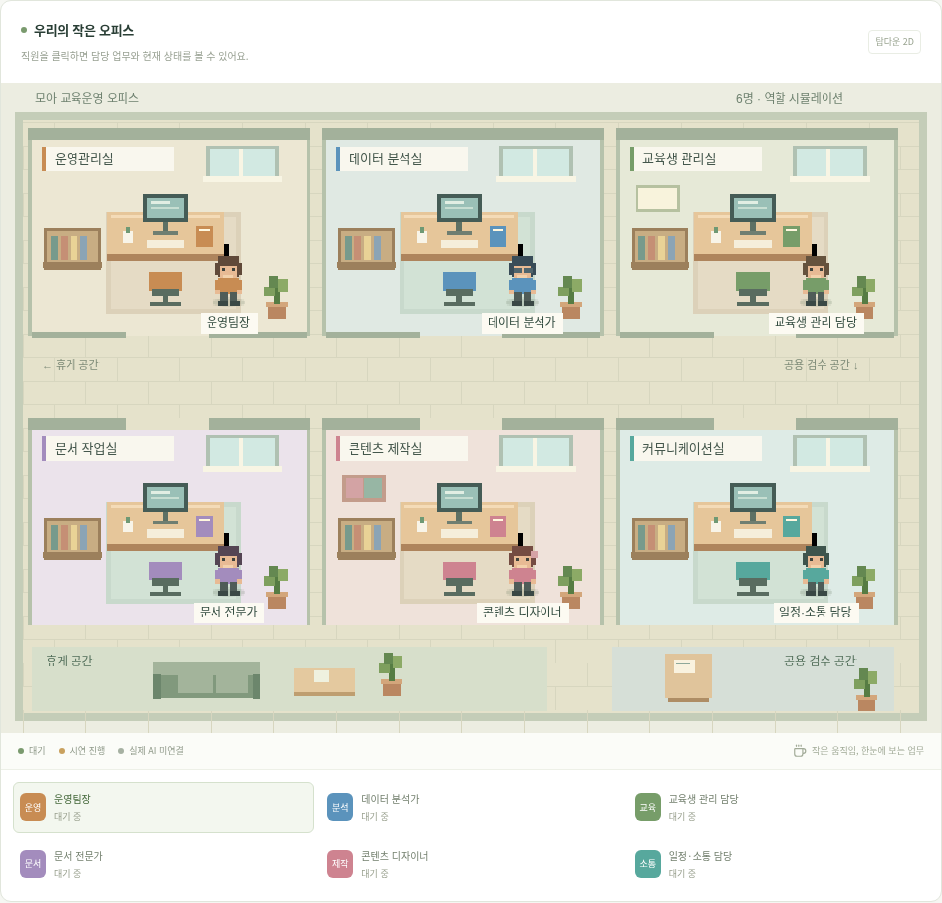
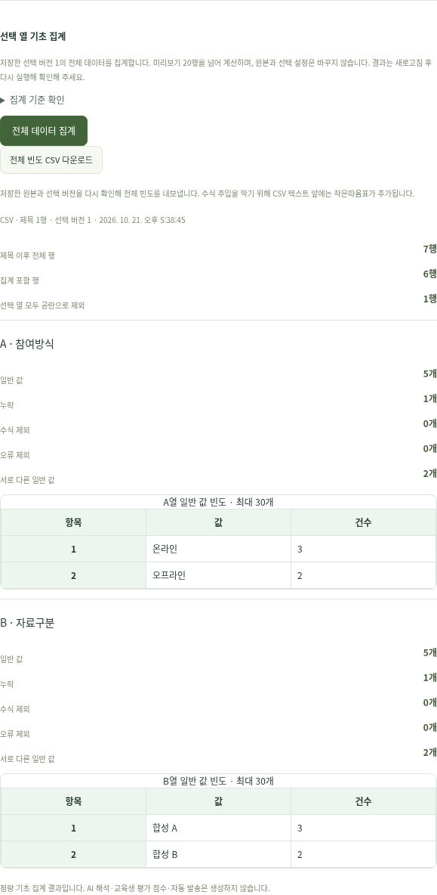
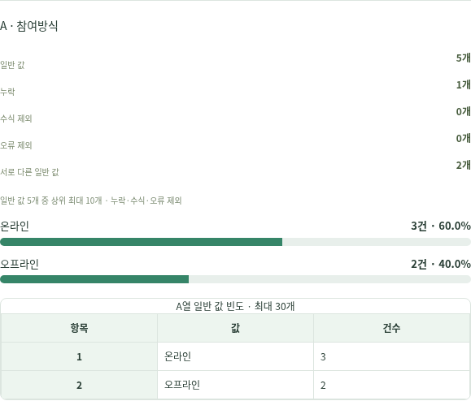
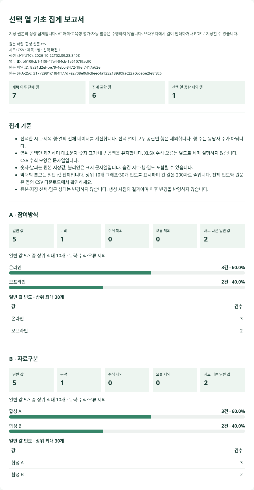

# 실제 앱 화면 확인

2026-10-21 클라우드 환경에서 빌드한 앱을 Chromium으로 실행해 촬영했습니다. 아래는 **실제 앱의 정적 스크린샷**이며 클릭해서 조작하는 공개 웹 앱은 아닙니다. 앱의 계정·파일·집계 기능은 API 서버와 함께 실행해야 합니다.

현재 연결된 도구에는 외부 접속용 미리보기 주소를 발급하는 기능이 없습니다. 확인하지 않은 공개 URL이나 클라우드 내부 localhost 주소를 사용자 접속 링크로 제공하지 않습니다. 직접 실행은 저장소 README의 `npm ci` → `npm run dev` 절차를 따릅니다. 서버 없는 단일 HTML은 오피스 시연 전용입니다.

촬영 전용 DB·원본 폴더에서 개인정보 없는 합성 설문만 사용했습니다. 비밀번호·복구 코드·세션·인증 해시는 촬영하지 않았습니다. 7개 데이터 행 중 선택 열이 모두 공란인 1행을 제외한 6행이 포함되며, 두 선택 열은 각각 일반 값 5개·누락 1개입니다. 행 수는 응답자 수가 아닙니다.

## 오피스 시연 화면

[모바일 오피스](images/office-current-mobile.png)

## 파일 미리보기·열 선택

[데스크톱 미리보기 전체](images/file-preview-desktop.png) · [모바일 미리보기 전체](images/file-preview-mobile.png)

## 기초 집계·CSV 다운로드

[모바일 집계 화면](images/summary-mobile.png)

[실제 다운로드한 합성 CSV](examples/summary-sample.csv)는 위 화면과 같은 원본·선택 버전에서 앱의 다운로드 버튼을 눌러 저장했습니다. CSV의 메타데이터와 해시는 이 합성 파일에만 해당합니다. 텍스트 앞의 작은따옴표는 수식 주입 방지용이며 원본 수정이 아닙니다.

## 2026-10-22 빈도 그래프·인쇄용 보고서

새 빌드의 실제 앱에서 별도 촬영 DB·원본 폴더의 합성 자료로 캡처했습니다. 기존 2026-10-21 캡처와 구분합니다. 전체 7행·포함 6행·제외 1행이며 두 열 모두 일반 값 5개·누락 1개입니다. 그래프는 3건/5개=60%, 2건/5개=40%를 표시합니다.

[데스크톱 전체 집계 화면](images/summary-graphs-desktop.png) · [모바일 전체 집계 화면](images/summary-graphs-mobile.png)

[실제 다운로드한 HTML 보고서](examples/summary-report-sample.html) · [그 HTML을 Chromium에서 A4로 인쇄한 PDF](examples/summary-report-sample.pdf)

HTML은 다운로드해 브라우저에서 열 수 있는 독립 보고서입니다. 로그인·업무 접수 기능이 있는 전체 앱의 공개 미리보기는 아닙니다. PDF는 인쇄 결과 예시이며 서버가 PDF를 생성하는 기능을 추가한 것은 아닙니다. 예시의 원본 해시·ID·생성 시각은 촬영용 합성 자료에 해당합니다.

